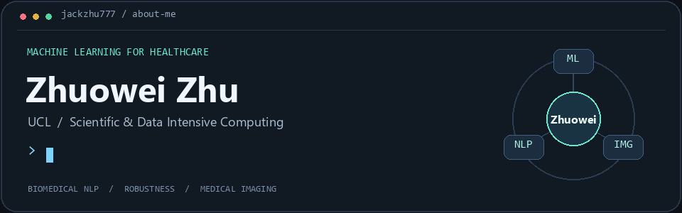

<picture>
  <source media="(prefers-reduced-motion: reduce)" srcset="./assets/header-healthcare-v3.png">
  
</picture>

**Machine Learning for Healthcare**

Robust Biomedical NLP · Medical Image Classification

MSc Scientific and Data Intensive Computing student at **University College London**

[🧭 About](#about-me) · [🔬 Research](#research-projects) · [🛠️ Skills](#technical-skills) · [💼 Experience](#experience)

<a href="./assets/header-healthcare-v3.png">View a still version of the banner</a> · <a href="https://github.com/JackZhu777?tab=repositories">Explore my repositories ↗</a>

## About me

I'm an MSc student at **University College London**, interested in applying **machine learning to medical problems**. My work connects **robust biomedical language understanding** with **medical image classification**.

For my undergraduate final-year project, I worked on improving the robustness of natural language inference over **clinical trial reports (CTR)**. My current postgraduate project focuses on **medical image classification**, extending this interest from clinical text to medical images.

My research experience includes fine-tuning models, designing data augmentation strategies, building training and evaluation pipelines, and running comparative and ablation experiments with **Python, PyTorch and Hugging Face Transformers**. I also bring Java, full-stack development and product design experience to building and communicating practical solutions.

## Research projects

### 🩻 Medical Image Classification

*Current postgraduate project · University College London · In progress*

I am currently working on **medical image classification** as part of my postgraduate studies, continuing my focus on applying machine learning to medical problems.

### 🧬 Robust Inference over Clinical Trial Reports

*Undergraduate final-year project · August 2025 – April 2026*

Investigated how to improve the **robustness of natural language inference over clinical trial reports (CTR)**. Fine-tuned **BioBERT and DeBERTa** on the SemEval-2024 Task 2 dataset and evaluated their responses to semantic perturbations, alongside classification performance.

**Selected result:** numerical QA auxiliary training increased DeBERTa's test **Faithfulness from 48.61% to 71.06%**, with **60.95% Control F1**, illustrating the trade-off between robustness and classification performance.

<strong>Explore the methods and evaluation</strong> · Robustness / Biomedical NLP / PyTorch

- Compared LLM-based semantic perturbation, numerical QA auxiliary training and BioWordVec-based vocabulary replacement through comparative and ablation experiments.
- Built an end-to-end training and evaluation pipeline in Python, PyTorch and Hugging Face Transformers.
- Evaluated Control F1, Faithfulness and Consistency to examine classification performance and robustness together.

## Technical skills

  &nbsp;&nbsp;
  &nbsp;&nbsp;
  &nbsp;&nbsp;
  &nbsp;&nbsp;
  &nbsp;&nbsp;
  

  &nbsp;&nbsp;
  &nbsp;&nbsp;
  &nbsp;&nbsp;
  &nbsp;&nbsp;
  &nbsp;&nbsp;
  

| Area | Technologies and methods |
| --- | --- |
| Machine learning | PyTorch, Hugging Face Transformers, biomedical NLP, CNNs, data augmentation |
| Research methods | Robustness evaluation, comparative experiments, ablation studies, model fine-tuning |
| Languages | Python, Java, JavaScript, SQL, HTML, CSS |
| Web development | Spring Boot, Vue, React, MySQL |
| Data and engineering | Data preprocessing, Power BI, Git, GitHub, pytest |
| Product and design | Figma, Axure, user research, requirements analysis, user stories, interactive prototyping |

## Other projects

Click a project's details to explore the implementation or design work.

### 💬 Emotional Support Application Prototype

*HCI group project · Project Lead · March – June 2025*

Led research involving **90+ questionnaire responses and seven student interviews**, then translated findings into prioritised requirements, user stories and an **11-page interactive prototype**.

<strong>Explore the research and design</strong> · HCI / User research / Prototyping

- Designed proposed AI dialogue and peer-support interactions, considering privacy and access to professional help.
- Coordinated four team members on design and presentation; the project received an **outstanding project award**.

### 👁️ Image Classification with CNNs

*Machine learning coursework*

Trained and evaluated convolutional neural networks on **CIFAR-10 using PyTorch**, gaining experience in image classification and model experimentation.

### 🧪 Python Testing in Practice

[**Explore time-tests →**](https://github.com/JackZhu777/time-tests)

<strong>See what the tests cover</strong> · Python / pytest / Boundary cases

A coursework exercise in testing time interval intersections. Added regression tests for non-overlapping ranges, ranges containing multiple intervals, and ranges that meet at an endpoint. Fixed overlap detection to include only intersections with positive duration.

All four tests passed at the completion of the exercise. [Read the tests →](https://github.com/JackZhu777/time-tests/blob/main/test_times.py)

## Experience

<strong>💼 Product & data experience</strong> · Nanjing University / AstraZeneca

**Product Intern · Institute of Future Technology Innovation, Nanjing University**

*June – August 2026*

Researched standards and competing products for a healthcare data governance and indicator platform. Developed requirements and interactive prototypes for data quality, catalogues, classification, access permissions and security, working across business, data and development teams.

**Data Analysis Intern · AstraZeneca, COO Department**

*June – August 2025*

Integrated regional commercial data and developed Power BI dashboards and monthly reports. Collaborated with business and data teams to check data accuracy and align metric definitions.

## Education

- **University College London** — MSc Scientific and Data Intensive Computing, 2026–2027 (expected).
- **Xi'an Jiaotong–Liverpool University** — BSc (Hons) Information and Computing Science, 2022–2026 · **First Class Honours**.

## Interests

Machine learning for healthcare · Model robustness · Biomedical NLP · Medical image classification

[↑ Back to top](#) · [Browse my code ↗](https://github.com/JackZhu777?tab=repositories)

